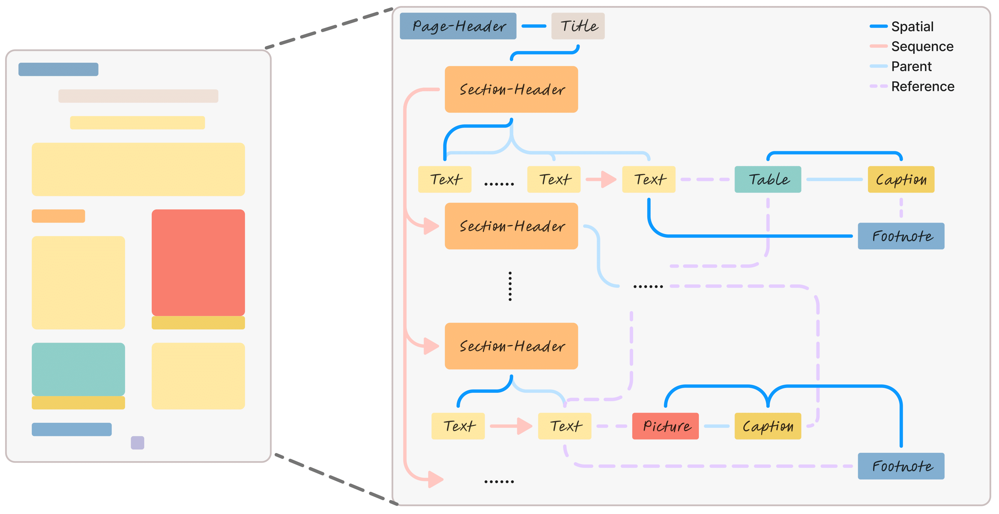

<h1 align="center">Graph-based Document Structure Analysis (ICLR'25)</h1>

<p align="center">
    <a href="https://arxiv.org/pdf/2502.02501.pdf">
    </a>
    <a href="https://yufanchen96.github.io/projects/GraphDoc/">
    </a>
    <a href="https://pytorch.org/get-started/previous-versions/#linux-and-windows">
    </a>
    <a href="https://github.com/yufanchen96/GraphDoc/blob/main/LICENSE">
    </a>
</p>

## 🏡 Project Homepage

This is the official repository for our ICLR 2025 paper **Graph-based Document Structure Analysis**. For more results and details, please visit our [project homepage](https://yufanchen96.github.io/projects/GraphDoc/).
    
## 🔎 Introduction
We construct a relation graph-based document structure analysis dataset (GraphDoc), enabling training models to complete tasks like reading order, hierarchical structure analysis, and complex inter-element relation inference. Furthermore, a document relation graph generator (DRGG) is proposed to address the tasks.
<p align="center">
    
</p>

## 📝 Catalog
- [x] Graph-based Document Structure Dataset
- [ ] DRGG Model Checkpoints
- [ ] DRGG Model Training Code
- [ ] DRGG Model Evaluation Code

## 📦 GraphDoc Dataset

The complete GraphDoc 80K release is available from
[Google Drive](https://drive.google.com/file/d/1QLMNc6SvODMbnhPFsYMb9_dMH1VCB4om/view?usp=sharing).

- 80,863 document page images
- 11 layout classes
- 1,107,625 layout annotations
- 4,138,423 relation triplets
- 8 relation types: `up`, `down`, `left`, `right`, `parent`, `child`, `reference`, and `sequence`

The archive contains only the three split annotation files and their referenced page images:

```text
GraphDoc_80K/
├── train.json
├── val.json
├── test.json
└── images/
    └── <page_hash>.png
```

The JSON files follow the COCO layout structure and add graph relation metadata through `relation_category`, per-instance relation fields, and `rels[*].triplets`.

The page images originate from [DocLayNet](https://github.com/DS4SD/DocLayNet) and remain subject to the [CDLA-Permissive-1.0 agreement](https://cdla.dev/permissive-1-0/). Upstream attribution and provenance metadata are preserved. The GraphDoc JSON files are modified and enhanced data derived from DocLayNet; layout and relation fields have been added or changed. The dataset package does not introduce an additional license.

## 📦 Code and Implementations

Code and implementation details will come soon!

## 🌳 Citation
If you find this code useful for your research, please consider citing:
```
@inproceedings{chen2025graphdoc,
      title={Graph-based Document Structure Analysis}, 
      author={Yufan Chen and Ruiping Liu and Junwei Zheng and Di Wen and Kunyu Peng and Jiaming Zhang and Rainer Stiefelhagen},
      booktitle={ICLR},
      year={2025}
}
```
